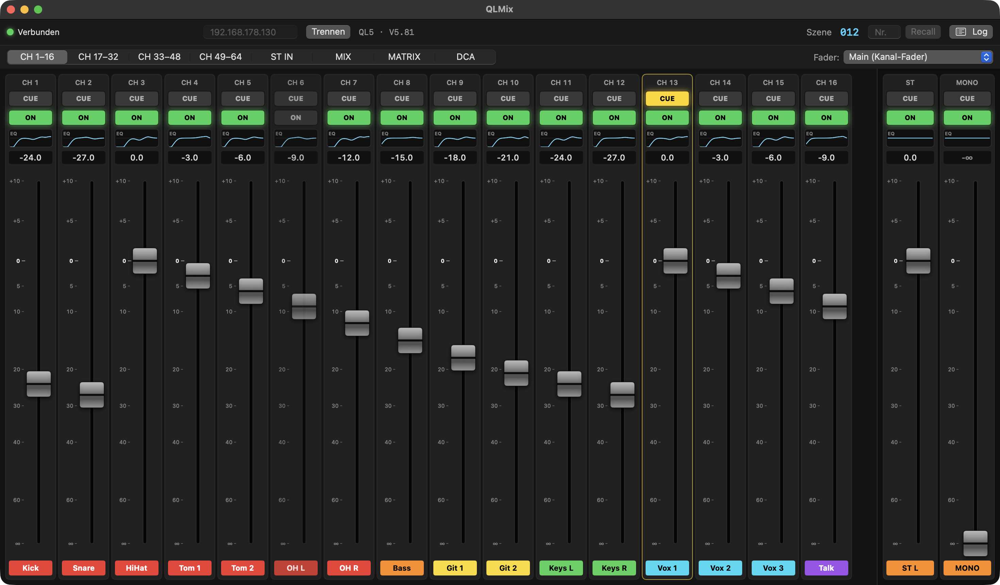

# QLMix – Yamaha QL/CL vom iPhone, iPad oder PC steuern

QLMix ist eine moderne Fernsteuerung für Yamaha-Digitalmischpulte der **QL-Serie** (QL1, QL5) und **CL-Serie**
(CL1, CL3, CL5) – als Alternative zur iPad-App StageMix. Ein kleiner Server läuft auf einem Rechner im Netzwerk
des Pults; bedient wird **im Browser** auf jedem Handy, Tablet oder Computer.

* Fader, ON, CUE für Eingänge, Stereo-Eingänge, Mix, Matrix, DCA und Summe
* **Monitormixe** (Sends on Fader) – Musiker stellen ihren In-Ear-Mix selbst am Handy ein (`/?mix=3`)
* **EQ und Hochpass** pro Kanal mit grafischer Kurve, Gain (Vorverstärker), Namen, Farben, Szenen, Meter
* läuft als App auf dem Home-Bildschirm (iPhone/iPad), optional mit PIN

<p align="center"></p>

---

## Installation auf einem Windows-PC (empfohlen)

QLMix läuft dann dauerhaft auf einem Windows-10/11-PC und startet **automatisch mit Windows** – ohne Anmeldung,
unsichtbar im Hintergrund. Der PC muss im **selben Netzwerk wie das Pult** sein (LAN-Kabel oder WLAN am selben Router).

### 1. Dateien herunterladen

**Variante A – mit Git (empfohlen, dann sind Updates ein Doppelklick):**
Eingabeaufforderung öffnen (Windows-Taste → `cmd`) und nacheinander eingeben:

```
winget install --id Git.Git -e
```

Eingabeaufforderung **schließen und neu öffnen**, dann:

```
git clone https://github.com/samuelklsn/QLMix.git C:\QLMix
```

**Variante B – ohne Git:** [ZIP herunterladen](https://github.com/samuelklsn/QLMix/archive/refs/heads/main.zip),
entpacken und den Ordner `QLMix-main` nach `C:\QLMix` verschieben bzw. umbenennen.

### 2. Installieren

Im Explorer **`C:\QLMix\web\windows\install.cmd`** doppelklicken und die Administrator-Abfrage mit **Ja** bestätigen.

Das Installationsprogramm …

1. fragt nach der **IP-Adresse des Pults** (steht am QL unter **SETUP → NETWORK**),
2. installiert bei Bedarf **Node.js**,
3. baut die Oberfläche,
4. richtet den **Autostart** ein (Aufgabe „QLMix“ in der Windows-Aufgabenplanung),
5. öffnet **Port 8080** in der Windows-Firewall (nur für das lokale Netzwerk),
6. startet QLMix und zeigt am Ende die **Adresse für das Handy** an, z. B. `http://192.168.1.50:8080`.

> Erscheint „Der Computer wurde durch Windows geschützt“: auf **Weitere Informationen → Trotzdem ausführen** klicken.

### 3. PC wach halten

**Einstellungen → System → Netzbetrieb und Energiesparen → Energiesparmodus: Nie.**
Am besten im Router außerdem festlegen, dass der PC **immer dieselbe IP-Adresse** bekommt –
dann bleibt auch die Adresse auf den Handys gleich.

### 4. Auf dem Handy öffnen

Handy ins WLAN des Pult-Netzwerks, in **Safari/Chrome** die angezeigte Adresse öffnen
(z. B. `http://192.168.1.50:8080`). Als App: **Teilen → Zum Home-Bildschirm**.

### Später

| Aufgabe | So geht's |
|---|---|
| Prüfen, ob QLMix läuft | Am PC `http://localhost:8080` öffnen · Protokoll: `C:\QLMix\web\qlmix.log` |
| Update einspielen | `C:\QLMix\web\windows\update.cmd` doppelklicken |
| Pult-IP ändern | In QLMix unter ⚙︎ Einstellungen – oder `install.cmd` erneut ausführen |
| Autostart entfernen | `C:\QLMix\web\windows\uninstall.cmd` doppelklicken |

> **EQ-Hinweis:** Läuft auf demselben PC auch der Yamaha **QL Editor**, stören sich beide bei der EQ-Steuerung –
> den Editor dann schließen. StageMix auf dem iPad stört nicht.

Weitere Details zur Web-Version (Bedienung, Musiker-Links, PIN, Mac/Linux): **[web/README.md](web/README.md)**

---

## Weitere Teile dieses Projekts

* **QLMix für macOS** – native SwiftUI-App (siehe unten) mit [Bedienungsanleitung als PDF](docs/QLMix-Anleitung.pdf)
* **QLSimulator** – simuliertes Pult zum Testen ohne Hardware

## Protokoll – warum keine Wireshark-Dumps nötig sind

StageMix nutzt ein proprietäres Binärprotokoll. Die Pulte sprechen aber zusätzlich das
**Yamaha Remote Control Protocol (RCP)**: ein zeilenbasiertes Textprotokoll über **TCP-Port 49280**,
das auch Crestron/Q-SYS/Companion verwenden. Ein Handshake ist nicht nötig – Verbinden und Befehle senden genügt.

```
→ get MIXER:Current/InCh/Fader/Level 0 0
← OK get MIXER:Current/InCh/Fader/Level 0 0 -1000          (−10.00 dB, Einheit 0.01 dB, −32768 = −∞)
→ set MIXER:Current/InCh/Fader/On 0 0 0                    (Kanal 1 aus = Mute)
← NOTIFY set MIXER:Current/InCh/Fader/Level 3 0 -500 "-5.00"   (Änderung am Pult / durch andere Clients)
→ mtrstart MIXER:Current/Mix/PostOn 100
← NOTIFY mtr MIXER:Current/Mix/PostOn PostOn 7e 6a 00 …    (ein Hex-Byte pro Kanal, dB = Wert − 126)
→ ssrecall_ex MIXER:Lib/Scene 5
```

| Funktion | Adresse | x / y |
|---|---|---|
| Fader | `MIXER:Current/<InCh\|StInCh\|Mix\|Mtrx\|St\|DCA>/Fader/Level` | Kanal / 0 |
| ON (Mute) | `…/Fader/On` | Kanal / 0 |
| Name / Farbe | `…/Label/Name`, `…/Label/Color` | Kanal / 0 |
| Cue | `MIXER:Current/Cue/<Seg>/On` | Kanal / 0 |
| Sends | `MIXER:Current/InCh/ToMix/Level`, `…/ToMix/On` | Kanal / Mix |

Besonderheiten: `StInCh` hat 16 Einträge (L = 2n, R = 2n+1), `St` hat 3 (ST L, ST R, MONO).

## Projektstruktur

```
Sources/
  YamahaQLProtocol/   Tokenizer, Parser (RCPMessage), Encoder (RCPCommand), Adressen,
                      Fader-Kurve (FaderLevel), Farben, Meter, Zeilen-Framing
  YamahaQLNetwork/    ConsoleConnection (actor): NWConnection, Reconnect mit Backoff,
                      Keepalive (devstatus runmode), Totverbindungs-Erkennung
  QLMix/              SwiftUI-App (@Observable MixerStore, Strips, Fader, Meter, Log, Settings)
  QLSimulator/        Fake-Pult zum Testen ohne Hardware
Tests/                31 Swift-Testing-Tests (Protokoll, EQ-Adressen, EQ-Kurve)
scripts/make-app.sh   baut build/QLMix.app (Release, ad-hoc signiert)
```

## Bauen & Starten

```bash
swift test                      # Protokoll-Tests
./scripts/make-app.sh           # → build/QLMix.app
open build/QLMix.app
```

Oder `Package.swift` in Xcode öffnen und das Schema **QLMix** starten.

### Ohne Pult testen

```bash
swift run QLSimulator --animate     # Fake-QL5 auf 127.0.0.1:49280, bewegt zufällig Fader
```

Dann in der App `127.0.0.1` eintragen und verbinden.

## Am echten Pult

1. Mac per Ethernet ins Netz des Pults (Pult-IP steht unter SETUP → NETWORK; Mac braucht eine IP im selben Subnetz).
2. IP in der App eintragen → **Verbinden** (⌘K).
3. Beim ersten Start fragt macOS nach „Lokales Netzwerk“ – erlauben.

## Bedienung

* **Fader**: relatives Ziehen (Klick springt nie), ⌥ = fein, Scrollrad ±0,5 dB (⌥: 0,1 dB), Rechtsklick → 0 dB / −∞
* **Ebenen**: ⌘1 … ⌘9 · **Neu synchronisieren**: ⌘R · **Log**: ⌘L
* **Sends on Fader**: Rechts oben „Fader: Sends → MIX n“ – die Eingangsfader steuern dann den Monitormix
* **Name/Farbe**: Klick auf das Namensfeld
* **Szenen**: Nummer eingeben → Recall (mit Bestätigung)
* **Log-Fenster**: Live-Traffic, Filter, und eine Eingabezeile für beliebige RCP-Befehle

### EQ

* Klick auf die kleine EQ-Kurve im Kanalzug (oder ⌘E) öffnet rechts den EQ-Editor.
* 4 Bänder (LOW / LO-MID / HI-MID / HIGH), LOW und HIGH umschaltbar Bell ↔ Shelf, HPF, EQ ON, Flat.
* Knoten in der Kurve ziehen = Frequenz + Gain, Scrollrad = Q (⌥ fein), Doppelklick = 0 dB, ‹ › = Kanal wechseln.

**Wichtig:** Yamaha dokumentiert die EQ-Adressen für CL/QL nicht, und die bekannte Parameterliste eines CL/QL
enthält keinen EQ. Die App verwendet deshalb das Adressschema der neueren Yamaha-Pulte (RIVAGE/DM7):

```
MIXER:Current/InCh/PEQ/On                 MIXER:Current/InCh/PEQ/Band/Freq  ch band  (Hz × 10)
MIXER:Current/InCh/PEQ/LowShelving/On     MIXER:Current/InCh/PEQ/Band/Gain  ch band  (dB × 100)
MIXER:Current/InCh/PEQ/HighShelving/On    MIXER:Current/InCh/PEQ/Band/Q     ch band  (Q × 1000)
MIXER:Current/InCh/HPF/On                 MIXER:Current/InCh/HPF/Freq       ch 0     (Hz × 10)
```

Beim Verbinden prüft die App, ob das Pult darauf antwortet (Varianten `PEQ` und `EQ`). Falls nicht, zeigt der
EQ-Editor das an. Dann im EQ-Editor oder Log-Fenster **„Parameterliste auslesen“** klicken. Die App fragt damit alle
Parameter des Pults ab (`prminfo 0…999`, `scninfo`, `mtrinfo`) und speichert sie unter `~/Documents/QLMix/`.
Mit dieser Datei lässt sich das Mapping exakt anpassen (`Sources/YamahaQLProtocol/EQ.swift`, `EQSchema`).

Simulator ohne EQ testen: `swift run QLSimulator --no-eq`

## Bekannte Grenzen / ungeprüft

* Getestet an einem **QL5 (Firmware V5.80a)**; CL-Pulte und QL1 sind vorgesehen, aber ungetestet.
* Der Windows-Installer ist noch nicht auf einem echten Windows-PC erprobt.
* RCP liefert auf CL/QL **nur Mix- und Matrix-Meter**, keine Eingangs-Meter.
* **EQ:** CL/QL geben EQ/HPF über RCP nicht heraus. QLMix Web nutzt dafür das Editor-Protokoll (SysEx über Port 50000) – siehe [web/README.md](web/README.md#eq-clql). Die Mac-App nutzt es noch nicht.
* Die Fader-Kurve (Position ↔ dB) ist an Yamaha angelehnt, aber nicht 1:1 identisch.
